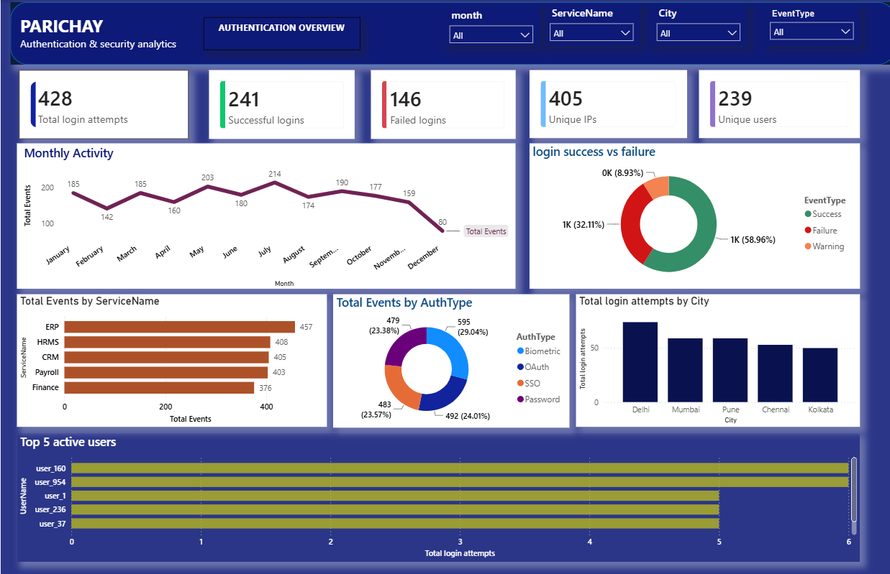
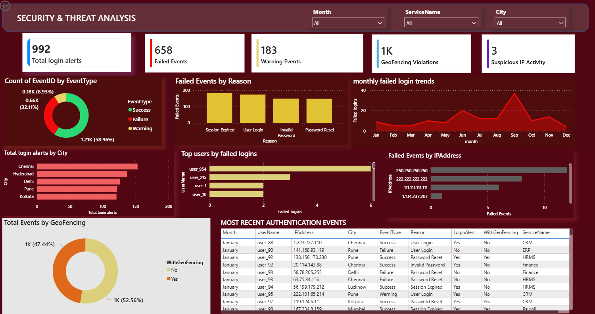
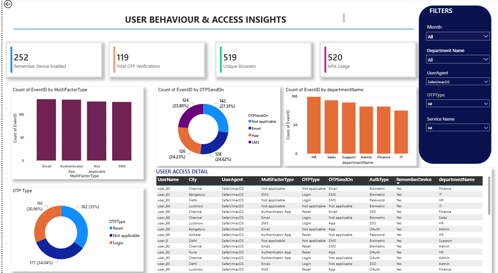

# Parichay- AI Powered authentication log analysis
Authentication Log Analysis using Python and data analytics to study login activity, authentication failures, suspicious access patterns, IP changes, and geofencing indicators.


Parichay combines authentication-log analytics, rule-based suspicious-activity detection, Python-based anomaly modelling, and a three-page Power BI dashboard.

> **Evaluation caveat:** The core 7-feature Isolation Forest achieved 89.2% accuracy on 500 unseen rows, but anomaly recall was only 5.88% (3 of 51 labelled anomalies detected). Accuracy should not be used alone to claim strong anomaly detection.

## Dashboard Pages

1. **Authentication Overview** — login KPI cards, monthly activity, success/failure/warning distribution, service events, authentication types, cities and active users.
2. **Security & Threat Analysis** — alerts, failures, warnings, geofencing, failed-login reasons/trends, top users/IPs and recent authentication events.
3. **User Behaviour & Access Insights** — remembered devices, OTP/MFA activity, authentication factors, departments and detailed user access records.

## Power BI Dashboard Image Preview

The dashboard has three pages covering authentication activity, security-related events, and user access behaviour. The images below illustrate the dashboard layout and its main visuals.

### 1. Authentication Overview



Shows login-attempt, successful/failed-login, unique-IP and unique-user cards, along with monthly activity, event types, services, authentication methods, cities and active users.

### 2. Security & Threat Analysis



Summarises login alerts, failed and warning events, geofencing indicators, failure reasons and monthly trends, plus user/IP breakdowns.

### 3. User Behaviour & Access Insights



Covers remembered-device status, OTP/MFA activity, authentication methods, department-level event counts and user-access details.

> **Model evaluation note:** The supplied results report 89.2% accuracy but only 5.88% anomaly recall (3 of 51 labelled anomalies detected) for the core 7-feature Isolation Forest on 500 unseen rows. Treat this as an experimental baseline; anomaly recall needs improvement.

## Architecture & Pipeline

```text
Authlogs_Final.csv
       |
       +--> Scala + Apache Spark (IntelliJ)
       |       - schema and category profiling
       |       - missing-value fill for OTP/MFA fields
       |       - failure/alert risk summaries
       |       - mobility and geofencing analysis
       |       - window-based impossible-travel and brute-force rules
       |       - OTP-abuse window logic
       |
       +--> Python + Jupyter
               - EDA and login filtering
               - previous-login comparisons
               - feature engineering
               - Isolation Forest training/prediction
               - evaluation with confusion matrix and classification report
                       |
                       v
                 Power BI (3 pages)
```

The two implementations share the same broad security-analytics goals, but they are not asserted to be line-by-line identical. The provided Spark source runs with `master("local[*]")`; no distributed-cluster throughput benchmark is included.

## Tech Stack

- **Scala / Apache Spark SQL:** DataFrame API, `groupBy`, aggregations, conditional expressions, timestamp parsing, `lag`, window ranges, `countDistinct`, caching.
- **IDE:** IntelliJ IDEA; Spark dependency managed through the Scala/SBT project.
- **Python:** Pandas, NumPy, Matplotlib, Seaborn.
- **Machine learning:** scikit-learn `IsolationForest` and metrics (`accuracy_score`, `precision_score`, `recall_score`, `f1_score`, `confusion_matrix`, `classification_report`).
- **BI:** Microsoft Power BI cards, slicers, line charts, donut charts, bar charts, and detail tables.

## Dataset & Feature Engineering

The Spark console output reports **2,049 records** in the input dataset. The schema includes event name/type, timestamp, username, IP, city/country, service, department, authentication type, MFA/OTP fields, login alert, geofencing, browser/device identifiers and fingerprint columns.

The notebook reports **1,379 login observations** and uses these seven core ML features:

- `IPChanged`
- `BrowserChanged`
- `StateChanged`
- `LoginFailure`
- `TimeDifferenceMinutes`
- `DistanceKM`
- `TravelSpeedKMH`

Feature-quality checks report **0 missing values**, **0 infinite values**, and **no constant features** in the 1,379 × 7 feature matrix.

## AI/ML & AI-Powered Analytics

This project combines rule-based security analytics with an experimental machine-learning workflow to help explore unusual authentication behaviour. The AI/ML component is intended as an analytical aid, not as a production security decision system.

### Feature Engineering

The Python notebook prepares login-level features for analysis, including:

- `IPChanged` — whether the IP differs from the previous login.
- `BrowserChanged` — whether the browser changes.
- `StateChanged` — whether the state/location changes.
- `LoginFailure` — whether the login event is a failure.
- `TimeDifferenceMinutes` — elapsed time between relevant login events.
- `DistanceKM` — estimated distance between consecutive login locations.
- `TravelSpeedKMH` — estimated travel speed between those locations.

The supplied notebook reports 1,379 login observations for the seven-feature matrix, with zero missing values, zero infinite values, and no constant features in that matrix.

### Anomaly Detection with Isolation Forest

An `IsolationForest` model from scikit-learn was trained using the seven core features. The documented configuration is `n_estimators=200`, `contamination=0.05`, and `random_state=42`.

On the documented 500-row unseen evaluation set, the model achieved 89.2% accuracy, 33.33% anomaly precision, 5.88% anomaly recall, and a 10.0% F1-score. It detected 3 of 51 labelled anomalies and missed 48. These results indicate that anomaly recall needs substantial improvement; accuracy alone is not evidence of reliable threat detection.

### AI-Assisted Analytical Workflow

The project uses Python-based feature engineering and model evaluation alongside rule-based analytics for impossible-travel patterns, failed-login bursts, geofencing indicators, and OTP-related activity. Power BI then presents the resulting authentication and access patterns in interactive dashboard pages. These components support investigation and reporting; they do not establish that an event is malicious without further validation.

## Detection Use Cases

- Failed-login profiling by user, department, service and IP.
- User mobility analysis across cities, browser IDs and IP addresses.
- Geofencing review for events where `WithGeoFencing = 'No'`.
- Impossible-travel rule: compare consecutive successful logins and assign risk by time gap; Python feature engineering also flags travel speed above 900 km/h.
- User-based brute-force windows: 10-minute window with Medium ≥3, High ≥5, Critical ≥10 failed attempts.
- IP-based brute-force windows: 10-minute window with Medium ≥5, High ≥10, Critical ≥20 failed attempts.
- OTP-abuse logic: 10-minute per-user window; output threshold ≥5 OTP verifications, with High at ≥6 and Critical at ≥10. The recorded Spark output for this use case is empty.
- User login behaviour profiling, service dependency, login time trends and previous-login change analysis.

## Key Findings

### Dataset / rule-based analysis
- **2,049** source records reported by Spark.
- **1,379** login observations used for core ML features.
- **6** observations exceed the notebook's impossible-travel threshold of 900 km/h; 1,373 do not.
- Highest feature correlation shown: `StateChanged` vs `DistanceKM`, **r = 0.839196**.
- Spark failure-IP counts shown: `250.250.250.250` = **12**, `222.222.222.222` = **8**, `111.111.111.111` = **6**.
- Authentication Overview cards: **428** login attempts, **241** successful logins, **146** failed logins, **405** unique IPs, **239** unique users.
- Security page cards: **992** login alerts, **658** failed events, **183** warning events, approximately **1K** geofencing violations, **3** suspicious IP activity.
- User behaviour cards: **252** remembered-device enabled, **119** OTP verifications, **519** unique browsers, **520** MFA usage.

### Isolation Forest model
Core model parameters: `n_estimators=200`, `contamination=0.05`, `random_state=42`.

Training-feature prediction distribution on 1,379 rows:
- Normal: **1,310 (95.0%)**
- Anomaly: **69 (5.0%)**

Unseen evaluation set: **500 rows**; confusion matrix:

| | Predicted Normal | Predicted Anomaly |
|---|---:|---:|
| Actual Normal | 443 | 6 |
| Actual Anomaly | 48 | 3 |

| Metric | Result |
|---|---:|
| Accuracy | 89.2% |
| Anomaly precision | 33.33% |
| Anomaly recall | 5.88% |
| Anomaly F1-score | 10.0% |

**Interpretation:** The model detected 3 of 51 labelled anomalies and missed 48. It predicted 9 anomalies in total, of which 3 were labelled anomalous. No false-positive reduction metric is available in the supplied files.

The notebook also contains a separate earlier/alternative evaluation result of 92.6% accuracy, 100.0% precision, 27.45% recall and 43.08% F1 (confusion matrix `[[449, 0], [37, 14]]`). Keep it separate from the core 7-feature evaluation unless its label mapping and prediction provenance are reconciled.

## Public Repository & Data Safety

Publish only code, documentation, and images approved for public sharing. Do not upload actual NIC authentication logs, personal information, credentials, tokens, or confidential IP/session details. Use synthetic or anonymised data for reproducible examples. Redact images first if they contain real or sensitive records.

## Setup

### Python / Jupyter
Create and activate a virtual environment if desired, then install the libraries used by the notebook:

```bash
pip install pandas numpy matplotlib seaborn scikit-learn jupyter
jupyter notebook
```

Open the supplied `.ipynb` and update the dataset path to the location of `Authlogs_Final.csv`.

### Scala / Apache Spark / IntelliJ
1. Install a compatible JDK and IntelliJ IDEA with Scala support.
2. Open the supplied Scala/SBT project.
3. Ensure the project's Spark SQL dependency matches the version used in the project configuration.
4. Update the CSV path in the source from the local Windows path to the path on your machine.
5. Run the main object. The supplied source uses `local[*]`, so it runs locally using available cores.

> The exact SBT dependency version should be taken from the uploaded build file/project configuration; do not assume a version if it is not included in the repository.

## Recommended Repository Structure

```text
Parichay/
├── python/
│   └── parichay.ipynb
├── scala-spark/
│   ├── src/
│   └── build.sbt
├── powerbi/
│   └── Parichay_Dashboard.pbix
├── images/
│   ├── authentication-overview.png
│   ├── security-threat-analysis.png
│   └── user-behaviour-access.png
└── README.md
```

## Limitations & Next Steps

- Improve anomaly recall: the core model misses 48 of 51 labelled anomalies in the held-out set.
- Tune contamination/decision thresholds and compare against a clearly documented baseline using the same split and label mapping.
- Investigate the six normal rows flagged as anomalies to understand false positives; do not claim a reduction without a before/after benchmark.
- Validate timestamp parsing, event definitions and synthetic/example-looking IP values before production interpretation.
- Verify the Scala brute-force window variable name (`user_Window` is defined, while `userWindow` is referenced in the aggregation) and run the actual project after correction if needed.
- Reconcile the approximate geofencing KPI with the exact measure definition used in Power BI.
- Do not claim cluster-level scalability or throughput gains without performance benchmarks.


